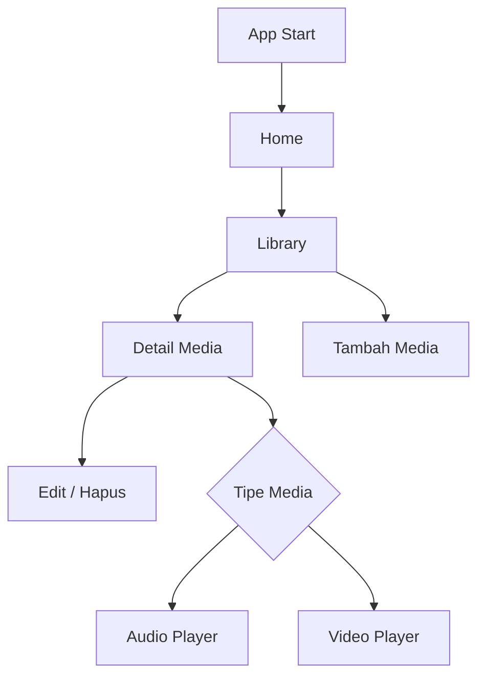

# PRD — MediaHub (Android)

**Versi:** 2.0 — 13 November 2026  
**Status:** Rancangan siap dijadikan panduan implementasi; belum menyatakan fitur sudah selesai  
**Proyek:** UTS Pemrograman Berbasis Mobile 2 — Flutter  
**Platform UTS:** **Android saja**. iOS masuk roadmap setelah UTS.

## 1. Identitas dan keputusan utama

| Item | Nilai final untuk UTS |
|---|---|
| Nama aplikasi | **MediaHub** |
| Deskripsi | Personal Multimedia Library & Player |
| Flutter project | `mediahub` |
| Android applicationId / namespace | `com.mediahubs.uts0035` |
| Firebase project ID | `mediahubs-bbf06` |
| Berkas konfigurasi Android | `android/app/google-services.json` |
| Database UTS utama | **Cloud Firestore** |
| Audio | `just_audio` |
| Video | `video_player` |
| Video YouTube | Opsional (`youtube_player_flutter`, setelah fitur inti) |
| UI | Flutter Material 3; aksen biru/hijau; logo MediaHub dengan latar putih |
| Development target | Android emulator/perangkat fisik |

Project ID dan Android package di atas telah dibaca dari berkas Firebase Android yang diberikan. **Belum terverifikasi:** Firestore aktif, lokasi database, nama collection saat ini, Rules publik telah diterapkan, serta keberhasilan koneksi runtime. Firebase Authentication tidak digunakan untuk akses Firestore pada keputusan UTS saat ini. File `google-services.json` bukan bukti bahwa semua layanan tersebut telah disiapkan.

## 2. Sasaran dan batasan

**Tujuan UTS:** membuat satu aplikasi Android Flutter yang dapat (1) membaca dan mengelola metadata media di Firestore melalui CRUD, (2) memutar audio, dan (3) memutar video, serta (4) menampilkan pengalaman Library modern yang mudah didemonstrasikan.

**Definisi produk:** MediaHub adalah pengelola daftar audio/video pribadi, bukan layanan streaming musik komersial. Firestore menyimpan **metadata dan URL**, bukan file MP3/MP4. File bawaan aplikasi disediakan dalam folder `assets/`.

**Keputusan ruang lingkup:** **Firestore-first untuk MVP UTS; hybrid bertahap.** Akses media offline sudah dibuktikan lewat assets pada tahap wajib. Import file dari perangkat dan penyimpanan katalog lokal SQLite menjadi fase ekspansi setelah P0 stabil; bukan syarat kelulusan fitur inti.

**Di luar cakupan UTS inti:** iOS, login UI, upload media ke cloud, otomatis memindai galeri/musik, sinkronisasi offline-cloud, playlist kompleks, background playback, dan rekomendasi AI.

## 3. Kesesuaian materi kampus

| Referensi pembelajaran | Materi | Bukti dalam MediaHub |
|---|---|---|
| Modul 1 Database Firebase (Pertemuan 1) | Setup Firebase/Firestore; `StreamBuilder` | Koneksi Firestore dan daftar media yang berubah saat data diperbarui |
| Modul 2 Database Firebase Lanjutan (Pertemuan 2) | `set`/tambah, `update`, `delete`, form, dialog konfirmasi | Form tambah/edit; hapus dengan konfirmasi |
| Modul 5 Play Audio Video (Pertemuan 5) | `just_audio`, `video_player`, assets, network, YouTube | Audio network, video assets; opsional YouTube |

**Kriteria dosen yang eksplisit:** database memilih Firestore atau MySQL REST API; audio asset atau network; video asset/network/YouTube. MediaHub memilih **Firestore + audio network + video asset** sebagai jalur minimum yang jelas. Pengujian media lain dapat memperkuat demonstrasi.

## 4. Prioritas fitur

| ID | Prioritas | Fitur | Hasil yang harus terlihat |
|---|---|---|---|
| P0-01 | Wajib | Firebase initialization | Aplikasi terhubung dengan project Firebase yang benar |
| P0-02 | Wajib | Read Firestore | Daftar media muncul otomatis dari koleksi Firestore |
| P0-03 | Wajib | Create Firestore | Form menambah dokumen media baru |
| P0-04 | Wajib | Update Firestore | Form mengubah judul, kreator, tipe, URL, dll. |
| P0-05 | Wajib | Delete Firestore | Konfirmasi penghapusan dan dokumen terhapus |
| P0-06 | Wajib | Audio player network | MP3/stream URL yang kompatibel dapat play/pause |
| P0-07 | Wajib | Video player asset | MP4 bundled asset dapat play/pause |
| P0-08 | Wajib | Navigasi & penanganan state | Home/Library/Player; loading, kosong, error |
| P1-01 | Tambahan | Video player network | Video langsung dari URL kompatibel dapat diputar |
| P1-02 | Tambahan | Search dan filter | Filter audio/video; pencarian judul/kreator |
| P1-03 | Tambahan | Mini audio player | Status putar tetap tampak saat navigasi |
| P1-04 | Tambahan | YouTube player | Video YouTube ditangani oleh player khusus |
| P2-01 | Ekspansi hybrid | Import media perangkat | Pilih file via file picker native |
| P2-02 | Ekspansi hybrid | SQLite + file privat | Metadata/file import bertahan dan offline |
| P2-03 | Setelah UTS | Playlist, favorit, riwayat, iOS | Fitur produk lanjutan |

**Aturan prioritas:** implementasikan dan uji seluruh P0 sebelum P1/P2. Jika waktu terbatas, kumpulkan MVP P0 yang stabil.

## 5. Pengguna dan user stories

**Aktor:** Pengguna aplikasi (tanpa halaman login pada MVP).

1. Sebagai pengguna, saya bisa melihat daftar media dari Firestore agar mengetahui koleksi tersedia.
2. Saya bisa menambahkan judul, kreator, tipe, dan URL media agar katalog bertambah.
3. Saya bisa memperbaiki data metadata yang salah.
4. Saya bisa menghapus data setelah menyetujui dialog konfirmasi.
5. Saya bisa memutar audio dari URL dan video dari asset.
6. Saya memperoleh pesan yang jelas jika internet tidak tersedia atau URL tidak bisa dimainkan.

## 6. Navigasi dan rancangan layar



| Layar | Elemen wajib | Interaksi / keadaan |
|---|---|---|
| Home | Logo/nama MediaHub, ringkasan koleksi, tombol ke Library | Navigasi ke koleksi |
| Library | List thumbnail, judul, kreator, ikon audio/video; FAB `+` | Refresh/realtime, empty, error |
| Detail | Judul, kreator, deskripsi, sumber, tombol Play/Edit/Delete | Navigasi player atau CRUD |
| Tambah/Edit | `TextFormField`, dropdown type, input URL, tombol Simpan | Validasi, loading, sukses/error |
| Audio Player | Judul, artwork placeholder, play/pause, progress/durasi | Loading, bermain, gagal |
| Video Player | Area video, play/pause, indikator loading | Inisialisasi, bermain, gagal |

**Alur demo utama:** buka Library → tambah media → lihat item → edit → putar audio → putar video bawaan → hapus item → cek Firestore Console.

## 7. Desain data Firestore

### 7.1 Struktur awal

**Collection yang diusulkan:** `media` pada root Firestore untuk MVP satu pengguna/demo. **Ini rancangan, bukan klaim bahwa collection sudah dibuat.**

```text
media (collection)
  └─ {autoDocumentId} (document)
       ├─ title
       ├─ creator
       ├─ type
       ├─ description
       ├─ category
       ├─ sourceType
       ├─ mediaUrl
       ├─ thumbnailUrl
       ├─ createdAt
       └─ updatedAt
```

| Field | Tipe | Wajib | Aturan |
|---|---|---|---|
| `title` | String | Ya | Tidak kosong, trim spasi |
| `creator` | String | Ya | Tidak kosong; boleh `Unknown` jika tidak diketahui |
| `type` | String | Ya | `audio` atau `video` |
| `description` | String | Tidak | Default kosong |
| `category` | String | Tidak | Contoh `Music`, `Education` |
| `sourceType` | String | Ya | `network` atau `asset` |
| `mediaUrl` | String | Ya | URL HTTPS untuk network atau path asset terdaftar |
| `thumbnailUrl` | String | Tidak | URL gambar/asset atau kosong |
| `createdAt` | Timestamp | Ya | Diisi saat create, gunakan server timestamp |
| `updatedAt` | Timestamp | Ya | Diperbarui saat edit |

Contoh isi ilustratif (URL di bawah **bukan URL aktif**):

```json
{
  "title": "Contoh Audio",
  "creator": "Demo Artist",
  "type": "audio",
  "description": "Audio untuk UTS",
  "category": "Music",
  "sourceType": "network",
  "mediaUrl": "https://example.org/sample.mp3",
  "thumbnailUrl": ""
}
```

**Catatan sumber asset:** hanya path yang memang dibundel di `pubspec.yaml` dapat diputar. Dokumen Firestore yang mencantumkan path asset tidak membuat file asset otomatis tersedia. Untuk demo video asset, boleh gunakan item bawaan aplikasi sehingga tidak bergantung pada Firestore.

### 7.2 Operasi data

| Aksi | Firestore API | Aturan UI |
|---|---|---|
| Read | `collection('media').snapshots()` | `StreamBuilder` / repository stream |
| Create | `.add(data)` | Validasi sebelum tulis |
| Update | `.doc(id).update(data)` | Jangan ubah `createdAt` |
| Delete | `.doc(id).delete()` | Dialog konfirmasi |

### 7.3 Keamanan Firestore — keputusan UTS (tanpa Authentication)

Pemilik project memilih Firestore tanpa Firebase Authentication. Media disimpan di koleksi root `media`; data CRUD kelas di koleksi root `users`. Kedua koleksi memakai akses publik bersama: siapa pun yang memakai client project dapat membaca, membuat, mengubah, dan menghapus record. Rules memvalidasi bentuk field dan timestamp, tetapi tidak mengidentifikasi pemilik dan tidak melindungi data dari perubahan oleh client lain. Jangan simpan data privat di koleksi ini.

Sebelum pengujian, buat database Firestore bila belum ada, tinjau lalu publish `docs/firestore.rules.example`, dan verifikasi CRUD tanpa Auth. Firebase Storage tetap di luar scope; berkas audio/video tidak diunggah. Tidak ada kredensial admin/service-account di aplikasi Flutter.

## 8. Teknologi dan struktur proyek

**Dependency inti:** `firebase_core`, `cloud_firestore`, `just_audio`, `video_player`, `provider` (opsional untuk state sederhana). Firebase Authentication tidak digunakan dalam keputusan akses UTS saat ini. `youtube_player_flutter`, `file_picker`, `sqflite`, `path_provider` hanya saat fitur terkait dikerjakan.

**Versi:** gunakan versi stabil yang kompatibel ketika coding, kemudian kunci versi di `pubspec.lock`. Periksa persyaratan plugin dan Android minSdk/compileSdk sebelum build; jangan menyalin nilai SDK dari modul lama tanpa verifikasi.

```text
mediahub/
├── android/
│   └── app/google-services.json
├── assets/
│   ├── images/logo_mediahub.png
│   ├── audio/sample.mp3         # opsional
│   └── video/sample.mp4
├── lib/
│   ├── main.dart
│   ├── app.dart
│   ├── models/media_item.dart
│   ├── repositories/media_repository.dart
│   ├── services/audio_service.dart
│   ├── screens/home_screen.dart
│   ├── screens/library_screen.dart
│   ├── screens/media_form_screen.dart
│   ├── screens/media_detail_screen.dart
│   ├── screens/audio_player_screen.dart
│   ├── screens/video_player_screen.dart
│   └── widgets/media_card.dart
├── test/
├── pubspec.yaml
└── README.md
```

Struktur ini sengaja sederhana untuk UTS dan dapat dipisah menjadi feature-based folders pada pengembangan berikutnya.

## 9. Instruksi implementasi berurutan

### Tahap 0 — Pemeriksaan prasyarat

1. Jalankan `flutter doctor`; pastikan Android toolchain, Android SDK, dan perangkat/emulator tersedia.
2. Periksa `flutter --version` dan `flutter devices`.
3. Pastikan Firebase project `mediahubs-bbf06` milik pengguna sudah dapat diakses.
4. Di Firebase Console, periksa **Firestore Data** dan **Rules**; simpan screenshot untuk dokumentasi.

**Output:** ringkasan versi Flutter, Android target, status Firebase.  
**Selesai jika:** semua prasyarat Android teridentifikasi; keputusan keamanan Firestore dibuat.

### Tahap 1 — Inisialisasi Android Flutter

1. Buat proyek: `flutter create --platforms=android --org com.mediahubs mediahub`.
2. Ubah `applicationId` dan `namespace` Android menjadi `com.mediahubs.uts0035`; bila package Kotlin/Java berbeda, sesuaikan referensi dan struktur terkait secara konsisten.
3. Pastikan aplikasi Android dengan package itu **sudah terdaftar** pada Firebase (sesuai file yang diberikan).
4. Ubah nama tampil menjadi `MediaHub`; siapkan logo dan tema.
5. Letakkan file Firebase dengan nama **`google-services.json`** (hapus sufiks `(1)` pada salinan untuk proyek) ke `android/app/`.
6. Integrasikan Firebase menggunakan alur FlutterFire CLI yang kompatibel; buat konfigurasi platform Android sesuai project terpilih. Jangan mengandalkan JSON saja untuk menyimpulkan Firebase telah diinisialisasi.
7. Tambahkan dependencies, daftarkan assets di `pubspec.yaml`, jalankan `flutter pub get` lalu `flutter run`.

**Output:** halaman awal MediaHub berjalan di Android.  
**Selesai jika:** build sukses, tidak crash saat `Firebase.initializeApp`, dan tidak salah package/project.

### Tahap 2 — Firestore model, repository, dan Read

1. Finalisasi collection + rules (lihat §7.3).
2. Buat `MediaItem` untuk konversi dokumen Firestore ↔ objek Dart; tangani timestamp dan field opsional.
3. Buat `MediaRepository` berisi fungsi stream list, create, update, delete.
4. Bangun `LibraryScreen` menggunakan stream data dan tampilkan loading/empty/error.
5. Masukkan **satu data contoh** yang memiliki URL audio valid dan dapat diakses untuk demonstrasi.

**Output:** daftar Firestore muncul pada Library.  
**Selesai jika:** perubahan di Firestore Console terlihat di UI tanpa restart aplikasi.

### Tahap 3 — Form CRUD

1. Buat form tambah dan edit (komponen dapat digunakan bersama).
2. Validasi judul, kreator, jenis, dan media locator sesuai sumber.
3. Tambahkan pesan sukses/gagal dan indikator proses simpan.
4. Gunakan Document ID untuk update/delete; sediakan konfirmasi sebelum hapus.
5. Uji alur create → read → update → delete sampai konsisten.

**Output:** CRUD media cloud utuh.  
**Selesai jika:** keempat operasi berhasil di UI dan tercermin di Console.

### Tahap 4 — Audio Player

1. Buat layar player `just_audio` untuk `mediaUrl` audio network.
2. Sediakan play/pause, indikator loading, waktu/progress dan seek jika tersedia.
3. Tangani exception URL tidak tersedia, jaringan mati, dan format tidak kompatibel.
4. Dispose controller ketika tidak dipakai.

**Output:** audio network diputar dari item Firestore.  
**Selesai jika:** audio demo bisa play/pause; URL rusak memunculkan error tanpa crash.

### Tahap 5 — Video Player dari assets

1. Tambahkan file video contoh yang legal digunakan dan kompatibel (misalnya MP4 H.264/AAC) di `assets/video/`.
2. Daftarkan path pada `pubspec.yaml`.
3. Buat layar player dengan `VideoPlayerController.asset`, inisialisasi asynchronous dan state loading/error.
4. Sediakan play/pause, indikator progress, dan dispose controller.
5. Tambahkan entry demo video asset di Home/Library.

**Output:** video asset diputar tanpa perlu koneksi internet.  
**Selesai jika:** video dapat dimainkan di emulator/perangkat Android walau koneksi dimatikan.

### Tahap 6 — Integrasi dan polish

1. Rapikan navigasi Home → Library → Detail → Player.
2. Tampilkan badge `Audio`/`Video` dan `Network`/`Asset` pada item.
3. Tambahkan filter sederhana bila P0 sudah stabil.
4. Pastikan tidak ada overflow UI pada layar ponsel target.

**Output:** demo alur end-to-end.  
**Selesai jika:** pengguna dapat mengelola metadata dan memutar media tanpa berpindah aplikasi.

### Tahap 7 — Uji dan dokumentasikan

1. Jalankan setiap test case di §10 pada Android.
2. Catat **Pass/Fail**, perangkat, versi Android, tanggal, hasil aktual, dan screenshot.
3. Perbaiki temuan P0 dan ulangi pengujian gagal.
4. Lengkapi README dan laporan UTS (lihat §11).

**Output:** aplikasi Android siap demo dan bukti pengujian.  
**Selesai jika:** seluruh test case inti P0 berstatus Pass dan screenshot tersimpan.

## 10. Black Box Test Cases

| ID | Langkah uji | Ekspektasi | Status awal |
|---|---|---|---|
| TC-01 | Buka aplikasi Android | Home muncul tanpa crash | Not Run |
| TC-02 | Buka Library dengan data Firestore | Dokumen muncul | Not Run |
| TC-03 | Tambah data media valid | Dokumen baru tersimpan | Not Run |
| TC-04 | Simpan form tanpa judul | Form menolak dan memberi pesan | Not Run |
| TC-05 | Edit judul media | Dokumen diperbarui | Not Run |
| TC-06 | Hapus lalu pilih Batal | Data tidak terhapus | Not Run |
| TC-07 | Hapus lalu konfirmasi | Dokumen terhapus | Not Run |
| TC-08 | Play/pause audio URL valid | Audio berfungsi | Not Run |
| TC-09 | Play URL tidak valid | Pesan gagal; tidak crash | Not Run |
| TC-10 | Putar video assets | Video tampil dan play/pause | Not Run |
| TC-11 | Putus internet saat buka cloud | Pesan offline/error sesuai kondisi | Not Run |
| TC-12 | Putar video asset saat offline | Tetap dapat diputar | Not Run |

**Catatan:** `Not Run` berarti belum diuji. Jangan tulis Pass atau screenshot hasil yang belum benar-benar dijalankan.

## 11. Format dokumentasi UTS dan bukti

| Bagian laporan | Isi | Bukti minimal |
|---|---|---|
| BAB I Pendahuluan | Masalah, tujuan, batasan Android | Identitas aplikasi |
| BAB II Kebutuhan | Fitur sesuai materi kampus dan requirement | Matriks fitur P0/P1 |
| BAB III Perancangan | Arsitektur Firestore, skema data, navigasi, use case, activity CRUD | Diagram dan wireframe |
| BAB IV Implementasi | Setup Flutter/Firebase, model, CRUD, player audio/video | Screenshot kode relevan, Console, UI |
| BAB IV Pengujian | Tabel TC-01 s.d. TC-12, Pass/Fail dan hasil aktual | Screenshot per skenario |
| BAB V Kesimpulan | Capaian, keterbatasan, peluang pengembangan | Ringkasan hasil |

**Konvensi dokumentasi:** `docs/screenshots/01-home.png`, `02-firestore-data.png`, `03-create.png`, `04-update.png`, `05-delete.png`, `06-audio.png`, `07-video.png`, `08-test-results.png`. Nama file adalah contoh; buat hanya dari tangkapan layar nyata.

## 12. Roadmap Hybrid setelah P0

**Fase P2 — Local Library:**

1. Tambahkan `file_picker`, `path_provider`, dan `sqflite`.
2. Pengguna memilih media melalui native Android picker.
3. Salin file ke direktori privat aplikasi; simpan **path relatif**, judul, jenis, tanggal di SQLite.
4. Buat filter Local / Cloud pada Library.
5. Gunakan player yang sama untuk file lokal atau URL network, dengan controller sesuai sumber.
6. Penghapusan entri lokal hanya boleh menghapus salinan internal aplikasi, **bukan file asli** pengguna.
7. Uji pemutaran saat offline dan setelah restart aplikasi.

**Setelah UTS:** iOS, playlist, favorites, riwayat, background audio, sinkronisasi pilihan pengguna. Build iOS baru dikerjakan dengan lingkungan macOS/Xcode saat roadmap dimulai.

## 13. Risiko, validasi, dan Definition of Done

| Risiko | Tindakan |
|---|---|
| Firestore belum aktif/rules tidak aman | Periksa Console dan buat rules yang sesuai sebelum CRUD |
| Package tidak sama dengan Firebase | Gunakan `com.mediahubs.uts0035`, bukan `com.mediahub.uts0035` |
| URL contoh tidak bisa dimainkan | Gunakan URL media langsung yang sah dan diuji pada Android |
| Codec video berbeda antar-perangkat | Pilih sampel MP4 yang kompatibel dan uji pada perangkat target |
| Asset tidak terbaca | Cek path dan indentasi deklarasi assets di `pubspec.yaml` |
| Plugin/SDK berubah | Verifikasi versi plugin dan persyaratan Android sebelum build |
| Waktu UTS terbatas | Bekukan scope di P0 sebelum mulai hybrid/YouTube |

### Checklist selesai UTS

- [ ] Build Android berjalan dengan nama **MediaHub** dan package yang benar.
- [ ] Firebase initialization berhasil dan database yang dipakai terverifikasi.
- [ ] Firestore dapat menampilkan media secara realtime.
- [ ] CRUD Create, Read, Update, Delete berhasil.
- [ ] Audio network dapat diputar dan dipause.
- [ ] Video asset dapat diputar dan dipause tanpa internet.
- [ ] Loading, empty, error, dan konfirmasi hapus berfungsi.
- [ ] Screenshot dan tabel Black Box Test terisi berdasarkan pengujian nyata.
- [ ] Laporan UTS menjelaskan apa yang **sudah** dan **belum** diimplementasikan.

---

**Langkah kerja berikutnya:** verifikasi Firestore **Data** dan **Rules** sesuai keputusan no-auth publik, lalu uji CRUD dari aplikasi. PRD ini adalah pedoman pengerjaan, **bukan laporan bahwa fitur telah dibuat**.
